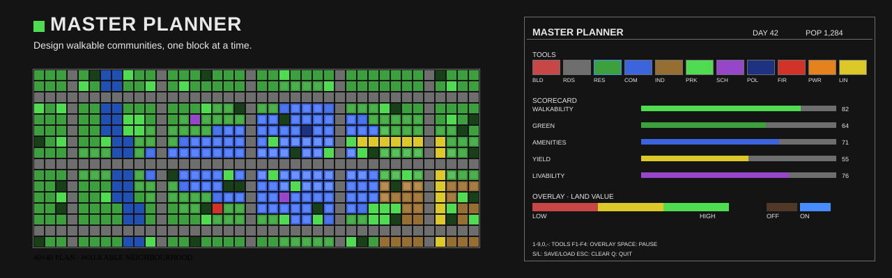
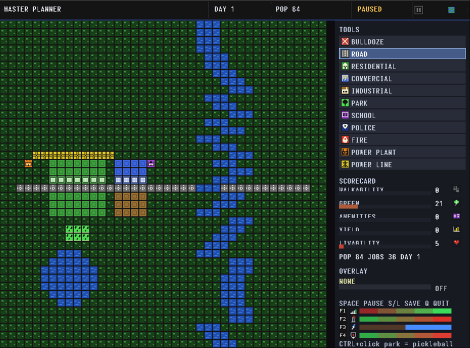

# Master Planner

A SimCity-style **master planned community builder** — a fast, minimal native
prototype to inspire property developers. Paint a plan (zones, streets, parks,
amenities) on a 40×40 tile grid and watch a live scorecard tell you how good a
place it is to live and invest. No failure states, no bankruptcy — a sandbox
for spatial thinking, in the spirit of the original 1989 SimCity.

Built in C11 + SDL2. Flat top-down tile graphics (SVG-sourced sprite atlas with
a zero-asset fallback). One `make` to build, one binary to run.



## Requirements

- Linux (Wayland or X11), gcc, make, pkg-config
- SDL2 and SDL2_ttf development packages

Arch / Omarchy:

```sh
sudo pacman -S sdl2 sdl2_ttf
```

Debian / Ubuntu:

```sh
sudo apt install build-essential pkg-config libsdl2-dev libsdl2-ttf-dev
```

Fedora:

```sh
sudo dnf install gcc make pkgconf-pkg-config SDL2-devel SDL2_ttf-devel
```

Optional (only for regenerating art from SVG sources): `librsvg`
(`rsvg-convert`) and ImageMagick.

## Build & run

```sh
git clone https://github.com/john-stalvern/master-plan-build-sim.git
cd master-plan-build-sim
make
./masterplanner
```

Headless checks (no window needed):

```sh
make test                      # unit tests + 50-tick smoke run
./masterplanner --smoke        # scripted plan, 200 ticks, scorecard JSON
./masterplanner --smoke --ticks 400
```

Example smoke output:

```json
{"walkability":42,"green":20,"amenities":0,"yield":16,"livability":18,"population":84,"jobs":36,"day":200}
```

`--smoke` is the QA harness: it builds a scripted plan, runs N ticks
(`--ticks N`, default 200), prints one line of scorecard JSON to stdout and
exits 0. It needs no display, so it works in CI and over SSH.

## Demo plan

A ready-made plan ships as a **generator**, not a checked-in binary — `demo.bin`
is a local, git-ignored artifact just like `plan.bin`. Generate it, copy it to
the path the GUI loads, and press `L` in the window:

```sh
python3 tools/make_demo.py     # writes ./demo.bin (11204 bytes, deterministic)
cp demo.bin plan.bin           # the GUI loads and saves plan.bin
./masterplanner                # press L to load the demo
```

The generator writes the exact `world_save()` format (`MPv1` magic + 40×40
tile grid + tree mask), reproducing the game's deterministic river, lake and
forest before stamping three powered residential neighbourhoods, main-street
retail, a school cluster, a park with a **pickleball court**, police/fire cover
and a small industrial patch. Verified with the real `world_load()` and
simulation code: after 200 ticks it loads cleanly and scores
`walk 68 / green 23 / amenities 34 / yield 38 / livability 40`,
population 756, jobs 108.

To paint your own demo instead: start `./masterplanner`, paint a road spine with
`2`, border it with `3`–`5` zones plus a `0` power plant and `-` power lines, add
a `6` park and a `7` school, then press `S` to save `plan.bin`. The `F1`–`F4`
overlays explain the score while you build.

## Controls

| Input | Action |
|---|---|
| Left click / drag on map | Paint with the selected tool |
| Sidebar click | Select tool |
| `1`–`9`, `0`, `-` | Tools: bulldoze, road, residential, commercial, industrial, park, school, police, fire, power plant, power line |
| **Ctrl + click a park** | Convert it to a **pickleball court** 🏓 |
| `F1` / `F2` / `F3` / `F4` | Overlays: land value / pollution / power / crime |
| `Esc` | Clear overlay (or quit if none) |
| `Space` | Pause / resume simulation |
| `S` / `L` | Save / load plan (`plan.bin`) |
| `Q` | Quit |

CTRL+click converts an existing park into a pickleball court — a recreational
amenity that counts as green space. Plain park placement is unchanged.

## How it works

You **zone**; the simulation decides whether development happens. Each tick
(one simulated day, ~0.5 s):

1. Power floods from plants across power lines to adjacent zones.
2. Pollution diffuses from industry, roads and coal plants.
3. Crime rises where land value is low and police are far.
4. Land value = downtown bonus + park/water adjacency − pollution − crime.
5. Zones grow (level 0→3) only with road access + power + desirability;
   otherwise they decay.

The scorecard (0–100 each) reads the result:

- **Walkability** — developed homes near shops/parks/schools (radius 4)
- **Green** — share of park, water and forest tiles
- **Amenities** — homes within radius 5 of a school and of commerce
- **Yield** — developed density vs theoretical maximum
- **Livability** — blend of the four, minus pollution penalty

Pickleball courts count as recreational green space, exactly like parks.

Definitions: `docs/scorecard.md`. Pattern stamps (village centre, green spine,
transit node, …): `docs/patterns.md`. Full interface contract: `docs/CONTRACT.md`.

## Screenshots

Captured from a real SDL window (920×680) by T5 QA. The four overlays make the
invisible model legible — toggle them with `F1`–`F4`.



| View | Capture |
|---|---|
| Baseline smoke plan | `assets/screenshots/smoke_plan_baseline.png` |
| Land value (F1) | `assets/screenshots/overlay_F1_landvalue.png` |
| Pollution (F2) | `assets/screenshots/overlay_F2_pollution.png` |
| Power (F3) | `assets/screenshots/overlay_F3_power.png` |
| Crime (F4) | `assets/screenshots/overlay_F4_crime.png` |

## Architecture

[Architecture & tick-order diagram (SVG)](assets/svg/ARCHITECTURE_TICK_ORDER.svg)

`main.c` owns the 60 fps SDL loop, input and timing; `sim.c` advances one day
every 500 ms; `render.c` draws the current state; `world.c` is the shared 40×40
tile model (`Tile` = type, level, powered, landValue, pollution, crime). One
tick is `power → pollution → crime → landValue → growth/decay → scorecard`;
each stage reads and mutates the tile grid, which is why overlays can visualise
the intermediate fields directly.

```
main.c      window, input, timing, --smoke harness
world.c/h   tile grid, placement, save/load
sim.c/h     simulation tick + scorecard
render.c/h  tiles, sprites, palette, HUD, overlays
assets/     SVG sources + PNG atlases (optional; flat fallback without them)
tools/      deterministic demo-plan generator (make_demo.py)
tests/      headless unit tests
docs/       contract, research, scorecard, patterns, asset manifest
```

Sprites are optional: with `assets/` present the app renders the tile atlas and
UI icons; without it, everything falls back to flat colour rectangles.

## Art pipeline

SVG is the source of truth; PNGs are generated and **optional**. `render_init()`
tries to load the atlases from `assets/`; a missing, unreadable or wrongly-sized
PNG disables only that element, which falls back to its flat-rect/text rendering.
The game is fully playable with no assets at all, and `--smoke` never needs them.
All builders are deterministic — rerunning them reproduces the committed PNGs
byte-for-byte.

```sh
cd assets
python3 verify_svgs.py     # 22 tile SVGs: size, palette, integer rects, borders
python3 build_atlas.py     # rsvg-convert SVGs -> tiles.png (112x64, 22 cells) + preview.png
python3 build_icons.py     # tool + metric icon strips
python3 build_legends.py   # overlay ramps, glyphs, tags, heat atlas
python3 build_cursors.py   # cursor markers + atlas
python3 build_hud.py       # top-bar HUD
python3 build_batch_b.py   # 8 deterministic UI PNGs (--check verifies them)
cd .. && python3 assets/verify_ui.py
```

`rsvg-convert` (librsvg) and ImageMagick are needed only to regenerate art.
The base atlas is 22 cells in a 7×4 row-major grid; cell 21 is the pickleball
court. Full layouts, palettes and censuses: `assets/README.md` and
`docs/asset-manifest.md`.

## Project status

Feature-complete prototype: core loop, GUI, simulation, sprite art, pattern
stamps, save/load and the pickleball feature are implemented. T5 QA passed —
clean build (zero warnings), unit tests, headless smoke, real-window interaction
and a save/load round-trip all verified.

## Roadmap

`docs/research.md` §8 sketches the phases after this prototype:

- Phase 1 — walking skeleton: window, grid, roads/zones, HUD *(done)*
- Phase 2 — feedback loop: power, land value, pollution, growth *(done)*
- Phase 3 — planner value: scorecard, overlays, pattern stamps *(done)*
- Phase 4 — polish: save/load and presets *(done)*; before/after comparison view
  and image/text report export *(next candidates)*

Research & design brief: `docs/research.md`.


---

## Agent token usage (snapshot at time of writing)

Measured from each Hermes profile's local `session_model_usage` ledger
(`state.db`). All API traffic went through Nous Portal. "Cache read" tokens are
prompt-cache hits; they are billed at a much lower rate than fresh input.
Costs marked `$0` are free-tier models. Snapshot is cumulative for this project
and will drift as work continues.

| Profile | Role | API calls | Input | Output | Cache read | Cache write | Reasoning | Models used |
|---|---|---:|---:|---:|---:|---:|---:|---|
| `default` | PM (this session) | 159 | 262,133 | 65,261 | 19,689,473 | 1,220,211 | 16,680 | qwen4-max, hy4-flash, deepseek-v4.1-flash |
| `mp-architect` | scaffold, contract, release | 68 | 90,850 | 70,283 | 2,729,537 | 131,485 | 43,228 | qwen4-max, hy4-flash, step-3.7-flash |
| `mp-sim` | simulation engine | 45 | 257,260 | 62,409 | 2,911,872 | 0 | 43,679 | hy4-flash |
| `mp-gui` | rendering + input/HUD | 178 | 459,610 | 221,754 | 13,087,616 | 0 | 152,781 | hy4-flash, step-3.7-flash |
| `mp-qa` | verification | 112 | 513,255 | 153,210 | 8,246,272 | 0 | 95,435 | hy4-flash, step-3.7-flash |
| `mp-design` | urban design content | 69 | 25,512 | 146,474 | 2,695,814 | 233,787 | 107,930 | qwen4-max, hy4-flash |
| `mp-art` | tile artist (SVG → atlas) | 350 | 1,017,818 | 510,672 | 14,883,456 | 0 | 338,733 | hy4-flash, step-3.7-flash |
| **TOTAL** | | **981** | **2,626,438** | **1,230,063** | **64,244,040** | **1,585,483** | **798,466** | |

Estimated cost recorded in the ledgers: **$5.02 USD** (most traffic on free
tiers; the figure is the provider's own estimate, not a bill).

Per-model token totals across all profiles:

| Model | Calls | Input | Output | Cache read | Reasoning |
|---|---:|---:|---:|---:|---:|
| `tencent/hy4-flash:free` | 715 | 2,586,426 | 953,526 | 41,963,264 | 653,907 |
| `qwen/qwen4-max` | 247 | 7,822 | 240,165 | 21,470,761 | 143,582 |
| `qwen/qwen4-max:free` | 9 | 61 | 3,074 | 1,620,639 | 789 |
| `stepfun/step-3.7-flash:free` | 12 | 25,740 | 34,745 | 2,176 | 0 |
| `deepseek/deepseek-v4.1-flash-1017` | 2 | 11,222 | 225 | 2,304 | 188 |

Note: `mp-design` produced 146k output tokens on only 25k fresh input — a very
high output/input ratio from extensive `qwen4-max` document drafting, much of
it later consolidated by PM.

---

## License

GNU General Public License, version 2 (GPLv2).

Copyright (C) 2026 Master Planner contributors.

This program is free software; you can redistribute it and/or modify it under
the terms of the GNU General Public License as published by the Free Software
Foundation; either version 2 of the License, or (at your option) any later
version.

This program is distributed in the hope that it will be useful, but WITHOUT ANY
WARRANTY; without even the implied warranty of MERCHANTABILITY or FITNESS FOR A
PARTICULAR PURPOSE. See the GNU General Public License for more details.

You should have received a copy of the GNU General Public License along with
this program; if not, write to the Free Software Foundation, Inc., 51 Franklin
Street, Fifth Floor, Boston, MA 02110-1301, USA.

The full license text is available at
<https://www.gnu.org/licenses/old-licenses/gpl-2.0.txt>.

Third-party component: `third_party/stb_image.h` is a vendored single-header
image loader in the public domain / MIT-licensed by Sean Barrett, used under
its own terms.
